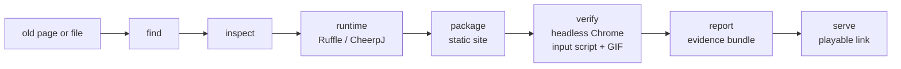

<div align="center">

# web-revive

### Give your agent the power to bring dead Flash and Java web games back to life, so they run in any modern browser again.

[](https://github.com/Abelo9996/web-revive/actions/workflows/ci.yml)
[](LICENSE)
[](package.json)
[](#use-it-with-your-agent)

<a href="https://abelo9996.github.io/web-revive/"></a>

<sub>Math Slash, a real open-source ActionScript 2 Flash game (<a href="examples/flash-mathslash">examples/flash-mathslash</a>), revived and recorded in one command: the GIF above is the gameplay clip <code>web-revive revive</code> saved from its headless-Chrome run.</sub>

**Play the revived games in your browser: [Math Slash](https://abelo9996.github.io/web-revive/math-slash/) (Flash) · [Reversi](https://abelo9996.github.io/web-revive/reversi/) (Java applet)**

[Try it](#try-it) · [Use it with your agent](#use-it-with-your-agent) · [Real revivals](#real-revivals) · [How it works](#how-it-works) · [Limits](#what-it-cant-do)

</div>

---

Found an old Flash game or Java applet that no browser will run anymore? Ask your agent to revive it.
web-revive gives it the operations to do that properly: find the embedded game (on a live page or, if the
page is gone, in the Internet Archive), inspect the file and judge whether it can run, fetch the right
runtime (Ruffle for Flash, CheerpJ for Java), package a static site, then open it in a real browser and
prove it works. You get a folder you can put on any static host, and a report of everything that was done
and checked.

## Try it

```bash
npm install -g web-revive          # or run it with npx web-revive ...
npx playwright install chromium    # the browser web-revive drives
```

Then revive a game in one command. Point it at a dead page, a direct `.swf`/`.jar`, a local file, or an
Internet Archive capture URL:

```bash
web-revive revive examples/flash-mathslash/MathSlash.swf --title "Math Slash"
```

It finds the game (recovering it from the Internet Archive if the page is gone), inspects it, fetches the
right runtime, packages a static site, opens it in headless Chrome, runs a short input script to get past
the menu, records a gameplay GIF, writes a report, and starts a preview server you can open:

```
  find examples/flash-mathslash/MathSlash.swf
  inspect MathSlash.swf
  runtime ruffle
  package
  verify (headless Chrome, input script, GIF)
  boots and animates at 58.1 fps

Revived in 10.4s. Boots and animates at 58.1 fps in headless Chrome.
Gameplay GIF: .web-revive/MathSlash/evidence/screenshots/gameplay.gif
Report: .web-revive/MathSlash/evidence/report.md

Play it at: http://127.0.0.1:52891/
```

Pass `--no-serve` to skip the preview server, `--no-gif` to skip the GIF, `--out <dir>` to choose the
workspace, and `--json` for machine-readable output. If a game cannot be revived, `revive` ends with an
honest reason (an AS3 feature gap, a JNI native library, a file found in no capture), not a false success.

The whole flow is still available as separate subcommands (`find`, `inspect`, `runtime`, `package`,
`verify`, `serve`, `report`) when you want to drive a step by hand.

## Use it with your agent

```bash
web-revive setup          # shows what it would change
web-revive setup --yes    # registers the MCP server with Claude Code, Codex and Cursor
```

Then just ask:

> "Revive this old Flash game and prove it runs: <url>."

The agent follows [`skills/web-revive/SKILL.md`](skills/web-revive/SKILL.md). For most requests it makes one
call to the `revive` tool, which finds the game (live or from the archive), inspects it, fetches the runtime,
packages, verifies in a real browser, gets past the menu, records a gameplay GIF, and returns the playable
link, the "boots" vs "reached gameplay" verdict, and what will not work offline, or an honest blocker. The
per-step tools (`find`, `inspect`, `runtime`, `package`, `verify`, `serve`, `report`) are there for when it
needs to drive a step by hand.

> `setup` registers `npx -y web-revive mcp`, which works once the package is on npm. Until then, point your
> agent at the local build instead: `claude mcp add web-revive -- web-revive mcp`.

## Real revivals

Every row was produced end to end on a Mac with web-revive. Each folder in [examples/](examples) has the
evidence bundle and a screenshot.

### One command, five real targets

These were each revived with a single `web-revive revive <source>` on an Apple Silicon Mac (Ruffle
nightly, CheerpJ 4.3). The game files are not redistributed here for the copyrighted ones; each folder keeps
only the report, a screenshot, and the gameplay GIF. Numbers are from one real run; the "boots" vs "reached
gameplay" verdict depends on whether a generic input script happened to get past that game's menu, so it can
vary between runs.

| Target | What it is | `revive` source | Result |
| --- | --- | --- | --- |
| [flash-qwop](examples/flash-qwop) | QWOP, Bennett Foddy's ragdoll runner (ActionScript 3) | `archive.org/download/flash_games/qwop.swf` | Reached gameplay, about 59.5 fps, GIF recorded |
| [flash-element-td](examples/flash-element-td) | Flash Element TD (2007), from a dead page recovered only from the Wayback Machine (capture 2007-02-03) | `http://www.novelconcepts.co.uk/flashelementtd/` | Reached gameplay, about 55.1 fps; `find` recovered the real 181 KB movie past a 3 KB sitelock stub |
| [flash-interactive-buddy](examples/flash-interactive-buddy) | Interactive Buddy, the classic AS2 sandbox toy | `archive.org/download/flash_games/interactive_buddy.swf` | Reached gameplay, about 58.1 fps |
| [flash-my-friend-pedro](examples/flash-my-friend-pedro) | My Friend Pedro, the original Flash version (AS2) | `archive.org/download/flash_games/my_friend_pedro.swf` | Boots and animates, about 60.0 fps |
| [java-dots-and-boxes](examples/java-dots-and-boxes) | Dots and Boxes, a real GPL-3.0 Java 1.1 applet (from [kwfenske](https://github.com/kwfenske/dots-and-boxes-game-java)) | `.../dots-and-boxes-game-java/raw/main/dotbox2b.jar` | Boots and animates in CheerpJ, about 5.1 fps; the applet and its license are kept in the folder |

### Driven step by step (0.1)

| Game | What it is | Result |
| --- | --- | --- |
| [flash-mathslash](examples/flash-mathslash) | Math Slash, a real open-source ActionScript 2 Flash game (GPL-3.0) | Plays in Ruffle, about 35.6 fps, intro animates into the menu, no console errors or warnings |
| [java-reversi](examples/java-reversi) | Reversi (Othello), a real GPL-3.0 Java 1.1 applet | Full board game runs in CheerpJ, interactive AWT applet, canvas draws and changes, no console errors |
| [java-foilsim](examples/java-foilsim) | FoilSim III, a NASA Java applet | Full simulator runs in CheerpJ, about 21.7 fps, canvas draws and changes |
| [flash-bounce](examples/flash-bounce) | A minimal Flash fixture, generated here (AS1/AS2 timeline, no ActionScript) | Plays in Ruffle, about 60 fps, stage draws and changes, no console errors |
| [wayback](examples/wayback) | A dead page and a dead file | `find` located Internet Archive captures and recovered the bytes; `inspect` reported honestly what they were |
| [bounce-as3](examples/flash-bounce) | The same fixture marked ActionScript 3 | `inspect` rates it `may-have-problems` and says Ruffle's AS3 support is only partial |

Two of these redistribute someone else's game, each under its own clear open-source license, kept next to the
file: Math Slash is GPL-3.0 and Reversi is GPL-3.0. FoilSim is the exception: it is NASA's work and its
repository states no license, so [examples/java-foilsim](examples/java-foilsim) keeps only the report and a
screenshot, not the `.jar`; the README there shows how to download it and reproduce the run. `flash-bounce` is
original MIT work generated in this repo, kept as a tiny self-contained fixture rather than the headline.

## How it works



`revive` runs that whole chain in one command. The individual steps:

| Step | What it does | Tools it drives |
| --- | --- | --- |
| `revive` | The whole chain end to end: find, inspect, runtime, package, verify (with the input script and gameplay GIF), report, then serve the playable link. Returns "boots" vs "reached gameplay", fps, the GIF, what will not work offline, or an honest blocker | all of the below |
| `find` | Parse `<object>`/`<embed>`/`<applet>`/swfobject on a page; if the page or file is gone, query the Internet Archive CDX API, pick the best capture, and download it | Internet Archive (Wayback CDX) |
| `inspect` | SWF: compression, version, stage, frame rate, AS1/AS2 vs AS3, external loads. Java: manifest, applet/main class, Java version, networking, file access, native libs. Then a verdict: likely / may have problems / not supported | |
| `runtime` | Fetch and cache Ruffle's self-hosted web build from its GitHub releases (records the tag and SHA-256); describe the CheerpJ CDN loader and its license | Ruffle releases, CheerpJ CDN |
| `package` | A self-contained static site sized to the stage: loading state, fullscreen, keyboard focus, an error panel, the game, the runtime, extra assets, and credits with the source URL and archive capture | Ruffle, CheerpJ |
| `serve` | Local preview with the correct wasm MIME type | |
| `verify` | Whether the game started, console errors, runtime warnings (unimplemented features), non-blank and changing frames, fps, scripted click and keys, screenshots | Playwright, Chromium |
| `report` | Markdown and JSON: source URL, captures, file hashes, runtime versions, commands, compatibility findings, verification results, limits | |

Every step is a CLI subcommand (add `--json`) and an MCP tool. The tool never calls an LLM.

## What it can't do

- Ruffle runs Flash, and its AS1/AS2 support is much more complete than its AS3 support. Many AS3 movies
  run; some use features Ruffle has not implemented yet. `inspect` flags AS3 and `verify` shows what breaks.
- CheerpJ runs JVM bytecode, not native code. A JAR that loads a `.so`/`.dll`/`.jnilib` (JNI) is reported as
  not supported. CheerpJ runs applets on Java 8; newer bytecode may not load.
- Browsers have no raw TCP/UDP sockets. Games that opened sockets (Flash `XMLSocket`, Java `java.net.Socket`)
  will not connect. CheerpJ networking is limited and needs its own backend.
- A game that loaded other files at runtime (more SWFs, XML, server calls) needs those too. `find` can pull
  them from the archive when they exist; server-side calls cannot be revived.
- This is an MVP: one game per run, Ruffle and CheerpJ as the runtimes, Flash and Java as the inputs.

## Rights and licensing

You need the right to share a game before you publish it. web-revive only works on your machine and never
uploads anything. The examples here redistribute only content that may be redistributed: `flash-mathslash`
(Math Slash) and `java-reversi` (Reversi) each ship under their own GPL-3.0 license, kept next to the file;
`flash-bounce` is original MIT work; and `java-foilsim` keeps only a report and screenshot because NASA's
FoilSim states no license. When you revive someone else's game, keep its license with it, or keep only the
report.

## Privacy

Everything runs on your machine. web-revive never calls an LLM and sends no telemetry. The only network
traffic is: the page or file you point it at; the Internet Archive (only when something is missing); the
Ruffle release download from GitHub; and, for Java, the CheerpJ loader, which the packaged page loads from
Leaning Technologies' CDN at runtime. Every request carries a User-Agent naming the tool, and `find` makes
one request at a time. `setup` only touches the three agent config files, backs them up first, and is a dry
run unless you pass `--yes`.

## License

MIT, Copyright (c) 2026 Abel Yagubyan. Revived games keep their own licenses. Ruffle is MIT/Apache-2.0.
CheerpJ is proprietary software from Leaning Technologies (free for personal use; check its license for
commercial use).
