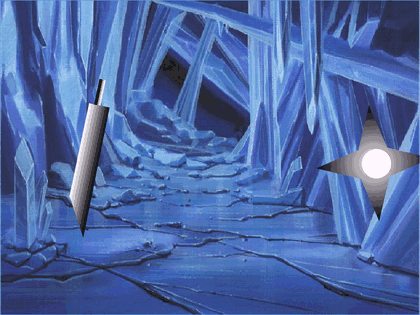

<div align="center">

# web-revive

### Give your agent the power to bring dead Flash and Java web games back to life, so they run in any modern browser again.

[](https://github.com/Abelo9996/web-revive/actions/workflows/ci.yml)
[](LICENSE)
[](package.json)
[](#use-it-with-your-agent)

<a href="https://abelo9996.github.io/web-revive/"></a>

<sub>Math Slash, a real open-source ActionScript 2 Flash game (<a href="examples/flash-mathslash">examples/flash-mathslash</a>), revived by web-revive and played in headless Chrome during <code>verify</code>.</sub>

**Play the revived games in your browser: [Math Slash](https://abelo9996.github.io/web-revive/math-slash/) (Flash) · [Reversi](https://abelo9996.github.io/web-revive/reversi/) (Java applet)**

[Try it](#try-it) · [Use it with your agent](#use-it-with-your-agent) · [Real revivals](#real-revivals) · [How it works](#how-it-works) · [Limits](#what-it-cant-do)

</div>

---

Found an old Flash game or Java applet that no browser will run anymore? Ask your agent to revive it.
web-revive gives it the operations to do that properly: find the embedded game (on a live page or, if the
page is gone, in the Internet Archive), inspect the file and judge whether it can run, fetch the right
runtime (Ruffle for Flash, CheerpJ for Java), package a static site, then open it in a real browser and
prove it works. You get a folder you can put on any static host, and a report of everything that was done
and checked.

## Try it

> Not on npm yet. Until the first release, install from GitHub:

```bash
git clone https://github.com/Abelo9996/web-revive && cd web-revive
npm install && npm run build && npm link   # puts `web-revive` on your PATH
npx playwright install chromium            # the browser `verify` uses
```

Then revive the open-source Flash game from the GIF above:

```bash
WS=/tmp/mathslash && mkdir -p $WS/game && cp examples/flash-mathslash/MathSlash.swf $WS/game/
web-revive inspect  $WS/game/MathSlash.swf --save $WS
web-revive runtime ruffle --save $WS
web-revive package $WS --title "Math Slash" \
  --source-url https://github.com/andy-shi88/MathSlash \
  --license examples/flash-mathslash/License.md
web-revive verify  $WS --seconds 5        # open $WS/site with `web-revive serve $WS/site` to play it
```

What `verify` printed on a fresh run (Apple Silicon, Ruffle nightly-2026-10-13):

```
Verify pass (flash/ruffle)
Started: true  Non-blank: true  Frames: 179, fps 35.6
  note: Stage content changed across the observation window.
```

## Use it with your agent

```bash
web-revive setup          # shows what it would change
web-revive setup --yes    # registers the MCP server with Claude Code, Codex and Cursor
```

Then just ask:

> "Revive this old Flash game and prove it runs: <url>."

The agent follows [`skills/web-revive/SKILL.md`](skills/web-revive/SKILL.md): find the game (live or from
the archive), inspect it, say plainly if it is not supported, fetch the runtime, package, verify in a real
browser, and back every claim with the recorded evidence.

> `setup` registers `npx -y web-revive mcp`, which works once the package is on npm. Until then, point your
> agent at the local build instead: `claude mcp add web-revive -- web-revive mcp`.

## Real revivals

Every row was produced end to end on a Mac with web-revive. Each folder in [examples/](examples) has the
evidence bundle and a screenshot.

| Game | What it is | Result |
| --- | --- | --- |
| [flash-mathslash](examples/flash-mathslash) | Math Slash, a real open-source ActionScript 2 Flash game (GPL-3.0) | Plays in Ruffle, about 35.6 fps, intro animates into the menu, no console errors or warnings |
| [java-reversi](examples/java-reversi) | Reversi (Othello), a real GPL-3.0 Java 1.1 applet | Full board game runs in CheerpJ, interactive AWT applet, canvas draws and changes, no console errors |
| [java-foilsim](examples/java-foilsim) | FoilSim III, a NASA Java applet | Full simulator runs in CheerpJ, about 21.7 fps, canvas draws and changes |
| [flash-bounce](examples/flash-bounce) | A minimal Flash fixture, generated here (AS1/AS2 timeline, no ActionScript) | Plays in Ruffle, about 60 fps, stage draws and changes, no console errors |
| [wayback](examples/wayback) | A dead page and a dead file | `find` located Internet Archive captures and recovered the bytes; `inspect` reported honestly what they were |
| [bounce-as3](examples/flash-bounce) | The same fixture marked ActionScript 3 | `inspect` rates it `may-have-problems` and says Ruffle's AS3 support is only partial |

Two of these redistribute someone else's game, each under its own clear open-source license, kept next to the
file: Math Slash is GPL-3.0 and Reversi is GPL-3.0. FoilSim is the exception: it is NASA's work and its
repository states no license, so [examples/java-foilsim](examples/java-foilsim) keeps only the report and a
screenshot, not the `.jar`; the README there shows how to download it and reproduce the run. `flash-bounce` is
original MIT work generated in this repo, kept as a tiny self-contained fixture rather than the headline.

## How it works


| Step | What it does | Tools it drives |
| --- | --- | --- |
| `find` | Parse `<object>`/`<embed>`/`<applet>`/swfobject on a page; if the page or file is gone, query the Internet Archive CDX API, pick the best capture, and download it | Internet Archive (Wayback CDX) |
| `inspect` | SWF: compression, version, stage, frame rate, AS1/AS2 vs AS3, external loads. Java: manifest, applet/main class, Java version, networking, file access, native libs. Then a verdict: likely / may have problems / not supported | |
| `runtime` | Fetch and cache Ruffle's self-hosted web build from its GitHub releases (records the tag and SHA-256); describe the CheerpJ CDN loader and its license | Ruffle releases, CheerpJ CDN |
| `package` | A self-contained static site sized to the stage: loading state, fullscreen, keyboard focus, an error panel, the game, the runtime, extra assets, and credits with the source URL and archive capture | Ruffle, CheerpJ |
| `serve` | Local preview with the correct wasm MIME type | |
| `verify` | Whether the game started, console errors, runtime warnings (unimplemented features), non-blank and changing frames, fps, scripted click and keys, screenshots | Playwright, Chromium |
| `report` | Markdown and JSON: source URL, captures, file hashes, runtime versions, commands, compatibility findings, verification results, limits | |

Every step is a CLI subcommand (add `--json`) and an MCP tool. The tool never calls an LLM.

## What it can't do

- Ruffle runs Flash, and its AS1/AS2 support is much more complete than its AS3 support. Many AS3 movies
  run; some use features Ruffle has not implemented yet. `inspect` flags AS3 and `verify` shows what breaks.
- CheerpJ runs JVM bytecode, not native code. A JAR that loads a `.so`/`.dll`/`.jnilib` (JNI) is reported as
  not supported. CheerpJ runs applets on Java 8; newer bytecode may not load.
- Browsers have no raw TCP/UDP sockets. Games that opened sockets (Flash `XMLSocket`, Java `java.net.Socket`)
  will not connect. CheerpJ networking is limited and needs its own backend.
- A game that loaded other files at runtime (more SWFs, XML, server calls) needs those too. `find` can pull
  them from the archive when they exist; server-side calls cannot be revived.
- This is an MVP: one game per run, Ruffle and CheerpJ as the runtimes, Flash and Java as the inputs.

## Rights and licensing

You need the right to share a game before you publish it. web-revive only works on your machine and never
uploads anything. The examples here redistribute only content that may be redistributed: `flash-mathslash`
(Math Slash) and `java-reversi` (Reversi) each ship under their own GPL-3.0 license, kept next to the file;
`flash-bounce` is original MIT work; and `java-foilsim` keeps only a report and screenshot because NASA's
FoilSim states no license. When you revive someone else's game, keep its license with it, or keep only the
report.

## Privacy

Everything runs on your machine. web-revive never calls an LLM and sends no telemetry. The only network
traffic is: the page or file you point it at; the Internet Archive (only when something is missing); the
Ruffle release download from GitHub; and, for Java, the CheerpJ loader, which the packaged page loads from
Leaning Technologies' CDN at runtime. Every request carries a User-Agent naming the tool, and `find` makes
one request at a time. `setup` only touches the three agent config files, backs them up first, and is a dry
run unless you pass `--yes`.

## License

MIT, Copyright (c) 2026 Abel Yagubyan. Revived games keep their own licenses. Ruffle is MIT/Apache-2.0.
CheerpJ is proprietary software from Leaning Technologies (free for personal use; check its license for
commercial use).
